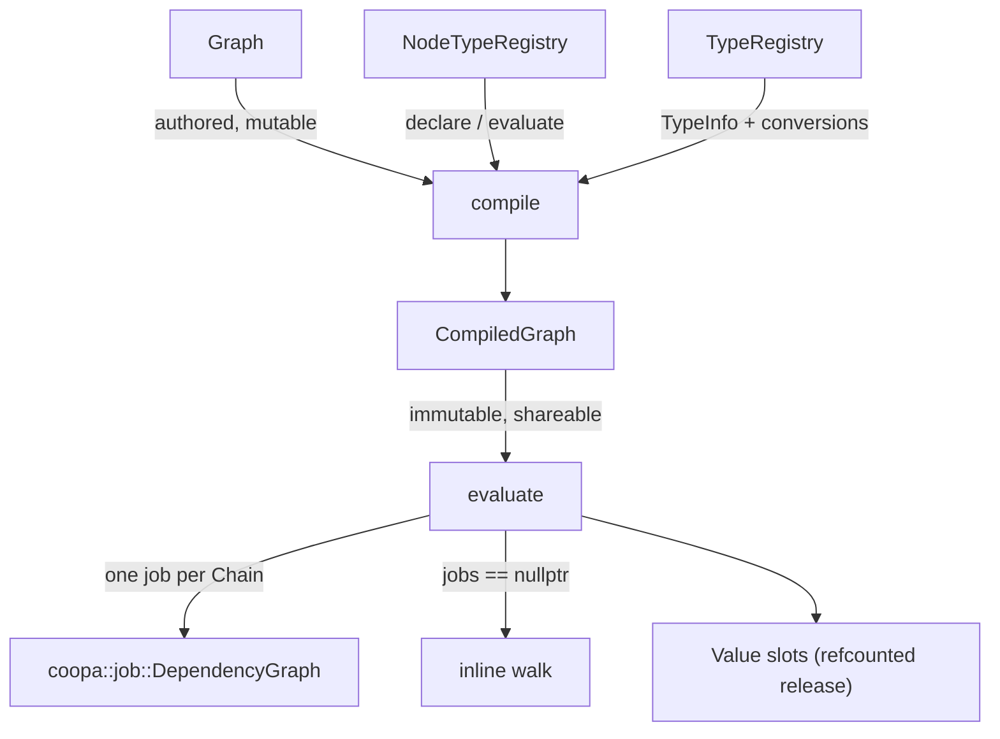

# Nodegraph Module (`coopa::nodegraph`)

A generic, job-parallel node-graph evaluator. It owns types, sockets, nodes, links, validation,
compilation and evaluation, and **knows nothing about any particular domain** -- a consumer
registers its own socket types and node types and the module drives them. Built on
[`coopa::job`](../job/README.md) for parallelism, and on [`coopa::yaml`](../yaml/document.h) for
serialization.

It suits more than one kind of graph, because nothing it owns is domain-specific: geometry graphs,
material parameter graphs, VFX graphs, audio graphs and logic graphs all reduce to "typed values
flowing along links between nodes". toyengine's `toyengine/procgraph/` is the first consumer.

## Architecture & Design



### Components

1. **[`TypeRegistry`](./type_registry.h)**
   - Runtime-registered socket types: `TypeId`, a `TypeInfo` of size/align plus
     construct/copy/move/destroy/equals/hash function pointers, and optional YAML hooks so socket
     defaults serialize for a type this module has never seen. Plus the implicit-conversion table
     (`Float -> Vector`, `Int -> Float`, ...).
   - Registered rather than templated **on purpose**: a `Graph<ValueVariant>` would bake each
     consumer's value set into the type, so two kinds of graph could not share one compiler.
2. **[`Value`](./value.h)**
   - A type-erased socket value. Small payloads live in a 32-byte inline buffer; larger ones share
     a reference-counted block, so fan-out is a refcount bump and writing is copy-on-write.
   - `as<T>(fallback)` **never throws** on a type mismatch, matching
     [`EventValue`](../event/event_bus.h)'s contract: graph data is authored, so a mismatch is a
     condition to report rather than crash on.
3. **[`declaration.h`](./declaration.h)**
   - `SocketDecl` / `NodeDeclaration` / `DeclarationBuilder`, and `PropertyBag` for a node's
     non-socket settings. A `PropertyBag` round-trips keys this build does not understand, so a
     graph authored against a newer build survives a load/save by an older one.
4. **[`NodeType`](./node_type.h)**
   - Two function pointers and a cost hint. `declare` computes the sockets **per node instance**
     from its settings -- which is what a Switch node, a Group node and a multi-input need, and
     what a static socket list cannot express. `NodeCost` tells the compiler which nodes are too
     cheap to deserve their own job.
5. **[`EvalContext`](./eval_context.h)**
   - The only thing a node body sees: its declared inputs, its declared outputs, its settings, the
     job engine, a cancellation flag and one opaque consumer pointer. No graph, no slot table, no
     scene. That narrowness is what makes a node unit-testable and lets one body serve both
     evaluation paths.
6. **[`Graph`](./graph.h)**
   - The authored form: nodes, links with multi-input ordering, and a named interface. The
     interface does double duty -- it is what a consumer binds values to, *and* the socket list a
     **Group** node exposes when another graph references this one, so a graph that works
     standalone works as a group with no extra authoring.
7. **[`graph_yaml.h`](./graph_yaml.h)**
   - Load and save, with an explicit `KeyOrder` so save -> load -> save is byte-identical.
8. **[`CompiledGraph` / `compile()`](./compile.h)**
   - Declare -> flatten groups -> bind inputs (inserting conversions) -> prune -> order -> fuse.
     Immutable once built, and safe to evaluate concurrently from many threads with different
     inputs.
9. **[`evaluate()`](./evaluator.h)**
   - The inline and job-parallel drivers over one shared `run_step_()`.
10. **[`Diagnostics`](./diagnostics.h)**
   - Thread-safe per-node errors, warnings and timings. Nothing in this module throws to report a
     bad graph.

## Usage Code Example

```cpp
#include <coopa/nodegraph/compile.h>
#include <coopa/nodegraph/evaluator.h>

using namespace coopa::nodegraph;

void setup_once() {
    // 1. Register the domain's socket types and any implicit conversions.
    auto& types = TypeRegistry::instance();
    const TypeId float_t = types.add<float>("Float");
    const TypeId vec_t   = types.add<glm::vec3>("Vector");
    types.add_conversion(float_t, vec_t, [](const void* s, void* d) {
        float f = *static_cast<const float*>(s);
        *static_cast<glm::vec3*>(d) = glm::vec3(f, f, f);
    });

    // 2. Register the domain's node types.
    register_node_type(NodeType{
        "Add", "Utility", "Add", "a + b", NodeCost::Trivial,
        [](DeclarationBuilder& b, const PropertyBag&) {
            b.input_default("a", TypeRegistry::instance().find("Float"), 0.0f);
            b.input_default("b", TypeRegistry::instance().find("Float"), 0.0f);
            b.output("result", TypeRegistry::instance().find("Float"));
        },
        [](EvalContext& ctx) {
            ctx.set("result", ctx.get<float>("a") + ctx.get<float>("b"));
        }});
}

float run(const Graph& graph, coopa::job::JobEngine* jobs) {
    Diagnostics diag;
    // Compile once; a CompiledGraph is immutable and may be reused across threads and frames.
    CompiledGraph compiled = compile(graph, GroupLoader(), {"result"}, diag);
    if (!diag.ok()) { /* diag.to_string() names the node and what was wrong */ return 0.0f; }

    EvalRequest request;
    request.graph    = &compiled;
    request.jobs     = jobs;            // nullptr runs inline on this thread
    request.priority = coopa::job::Priority::Low;
    EvalResult result = evaluate(request);
    return result.outputs.empty() ? 0.0f : result.outputs[0].as<float>(0.0f);
}
```

## The four properties that drive the design

**1. The inline path is not a fallback.** `jobs == nullptr` runs every chain on the calling thread,
matching [`coopa::scene::FrameContext::jobs`](../scene/scene_system.h)' documented contract. Both
drivers share `run_step_()` and the same slot arithmetic, so "the parallel result equals the inline
result" is structural rather than lucky -- and it is asserted directly in
`tests/nodegraph_eval_test.cpp`.

**2. Cheap nodes must not get their own job.** Submitting a job costs a handle allocation, a deque
push, possibly a condition-variable wake and a cache miss; a Math node costs nanoseconds. Without
fusion a utility-heavy graph would be *slower* with threads than without. So the compiler collapses
runs of `Trivial`/`Cheap` single-consumer nodes into one `Chain`, and a chain is the unit of
submission.

**3. An exhausted job-handle pool is a correctness hazard.** `JobEngine::create_handle()` returns
an **invalid** handle when its fixed pool is empty, and an invalid handle reports as *already
complete* -- so a chain submitted against one runs before its inputs exist, silently producing
wrong results. The evaluator therefore takes **every** handle before submitting **anything**, and
drops to the inline path if any one of them is invalid. Correct, merely serial, and warned about.

**4. Slot release is reference-counted, not positional.** Each slot knows how many steps read it; a
step that has run decrements every slot it read, and whichever decrement reaches zero clears it.
Releasing at "the last reader in topological order" would be wrong under the parallel driver, where
topological position says nothing about which step finishes last. This is what stops a chain of
large payloads from holding every intermediate alive to the end.

## Limits

- **No per-element "field" evaluation yet.** Blender-style fields (a value that is a function of
  per-element context, evaluated over N elements with virtual arrays) are designed for but not
  built: `varray.h` and `multi_function.h` do not exist. A consumer that needs per-element work
  does it inside one node today, using `EvalContext::jobs()->parallel_for()`.
- **Lazy inputs are declared but not deferred.** `SocketFlags::Lazy` and `EvalContext::request()`
  exist and are honoured as plain reads; nothing yet defers a sub-graph so a Switch node can skip
  the branch it does not take. `CompiledGraph::has_lazy_inputs()` is the hook for it.
- **No GPU evaluation.** Everything runs on the CPU over the job engine.
- **A node cannot add or remove nodes.** The graph is fixed at compile time; there is no
  self-modifying graph and no unbounded recursion (a Repeat zone would be a compile-time unroll).
- **Conversions are not chained.** `Int -> Vector` needs its own registration even when
  `Int -> Float` and `Float -> Vector` both exist; the compiler looks for one direct conversion
  rather than searching for a path.
